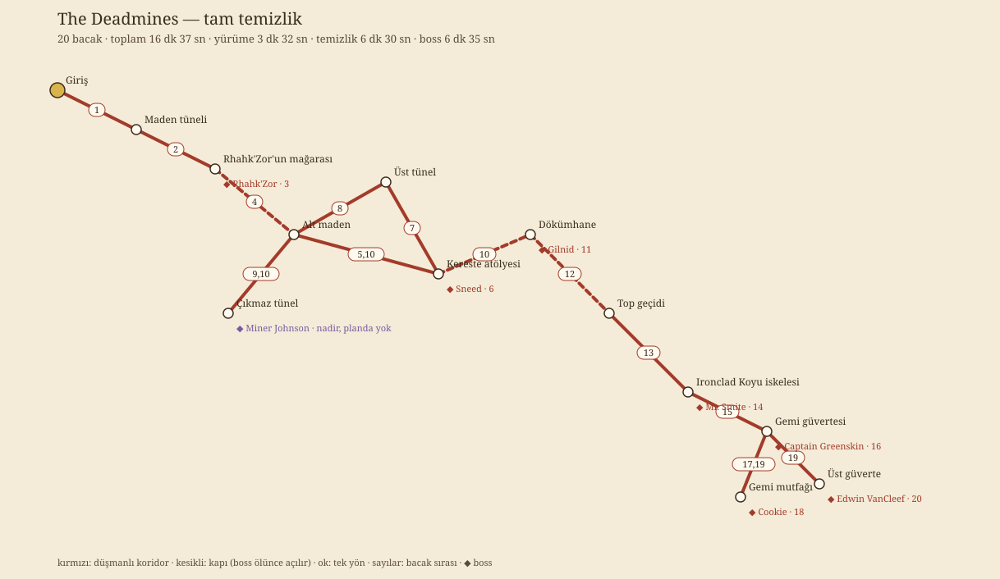

# AtlasSweep — Zindan Tam Temizlik Rotası

**Yazar:** Rabia Betül Polat

World of Warcraft için, Savaş Takan'ın **Atlas** algoritmasıyla ([savastakan/atlas](https://github.com/savastakan/atlas)) çalışan zindan eklentisi. Bir zindanın bütün düşmanlı koridorlarını ve bosslarını **en az geri dönüşle** dolaşan yolu planlar. Oyun sırasında düşman ve boss ölümlerinden ilerlemeyi izler, plandan sapılırsa yeniden planlar.

Atlas'ın asıl problemi "bir grafın **bütün kenarlarını** az maliyetle dolaşmak"tır. Zindan temizliği tam olarak bu problemdir: düşmanlar koridorlarda durur, her koridordan en az bir kez geçmek gerekir, çıkmaz tüneller ve kapılar geri dönmeyi zorunlu kılar. Problem, yönsüz kırsal postacı problemine (rural postman) yakındır. Kod Lua 5.1 uyumludur (WoW'un Lua sürümü). `core/` ve `data/` klasörleri oyunun içinde de dışında da aynen çalışır.



## Atlas

Atlas, kenarları etiketli yönlü bir grafta tek bir yürüyüşle bütün kenarları kapsamaya çalışan bir sezgiseldir. İlk kullanım amacı sonlu durum makinelerinden (FSM) test dizisi üretmektir. Yürüyüşün son kenarından başlayarak her turda:

1. erişilebilen kenarları DFS ardıl-sırasıyla (post-order) bir yığına koyar,
2. yığını ters sırayla açarak en uzun yol dinamik programlaması yapar: yürüyüşte olmayan kenar 1, olan 0 değerindedir,
3. en yüksek puanlı zinciri yürüyüşe ekler; yeni kenar getiren zincir kalmayınca durur.

`core/atlas.lua` Java kodunun birebir çevirisidir. Atlas'ın sonucu, bir düğümün çıkan kenarlarının hangi sırayla gezildiğine bağlıdır. Java'da bu küme `HashSet<Integer>`'dır ve sırası ekleme sırası değil, kova sırasıdır. `core/graph.lua` bu sırayı taklit eder. "Erişildi" işareti `Integer.MIN_VALUE` ile ve Java aritmetiğiyle tutulur. DFS özyinelemeli değil yığınlıdır; sonuç aynıdır ama WoW'da derin özyineleme riskli olduğu için böyle yazıldı.

**Doğrulama:** 12 FSM üzerinde (6 durumlu `bbtas`'tan 1200 kenarlı makinelere) Lua çevirisi Java ile **karakteri karakterine aynı** test dizisini üretir (`tools/compare_java.lua`). Java çıktıları `tests/fixtures/*.java.txt` içinde saklıdır, testler Java'ya gerek duymaz.

Java kodunun iki özelliği korunmuştur. Son turda yürüyüşün son kenarı yürüyüşten çıkarılarak dönülür; `keepLast = true` verilirse geri eklenir. Hiçbir kenar gevşetilemezse Java kodu `cost[Integer.MIN_VALUE]` okur ve çöker; Lua çevirisinde bu durumda yürüyüş biter.

## Zindan modeli (`core/sweep.lua`)

| Graf öğesi | Zindanda anlamı |
|---|---|
| düğüm | oda ya da kavşak |
| koridor = iki yay | iki yönde yürünebilir; `oneway` ise tek yön (aşağı atlama) |
| yay süresi | uzunluk / yürüme hızı; düşmanlı koridorun **ilk** geçişine temizlik süresi eklenir (düşman sayısı × düşman başı süre) |
| kapı (`gate`) | koridor, belirtilen boss ölmeden kullanılamaz (Deadmines kapıları) |
| boss | odasında kendi üzerine dönen yay; ağırlığı dövüş süresi; `requires` ile önkoşul (Mutanus için dört Fanglord) |

Yapılması gereken her şey bir **görev**dir. Bir görev, yaylarından herhangi biri geçilince kapsanır:

- **tam temizlik** (`full`): düşmanlı her koridor ve her boss,
- **boss koşusu** (`boss`): yalnızca bosslar; yoldaki düşmanlar yine temizlenir ve süreye eklenir,
- isteğe bağlı: **nadir bosslar** (`rares`) ve sonda **girişe dönüş** (`exit`, diğer bütün görevlerden sonra).

Koridorun iki yayı vardır ama görevi tektir. Atlas'ta ise her kenar ayrı bir gerekliliktir. Fark bu yüzden: zindanda her koridordan tek yönde geçmek yeter.

### Planlama: ağırlıklı Atlas

Her tur bir Atlas turudur:

1. yürüyüşün son yayından erişilen, kapısı açık yaylar DFS ardıl-sırasıyla dizilir,
2. bu sıra üzerinde en uzun yol DP'si çalışır: `puan(n) = puan(e) + yeni(n)·λ − maliyet(n)`,
3. seçilen zincir yürüyüşe eklenir; gerekli görev kalmayana kadar sürer.

Oyun için eklenenler:

- **Maliyet = kaçınılabilir süre.** Gerekli koridorların temizliği ve boss dövüşleri her planda aynıdır. Bunlar maliyete katılırsa planlayıcı bir bossun odasından geçip "pahalı" dövüşü sonraya bırakır (ilk sürümde bu hata görüldü). Maliyet yürüme süresi ile gerekmeyen koridorların (boss koşusunda ya da atlanan görevlerde) temizlik süresinden oluşur. Planın gösterdiği toplam süre ise her şeyi içerir.
- **Birden çok DFS sırası.** DP yalnızca DFS sırasında ileri giden yayları izler. Bu yüzden komşular 6 ayrı sırayla gezilir: veri sırası, önce yakın, önce uzak ve sabit tohumlu üç karıştırma.
- **λ taraması.** λ = BÜYÜK Atlas'ın kendi kuralıdır: önce çok yeni görev, eşitlikte az maliyet. Daha küçük λ'lar daha kısa, yakın zincirler üretir. Her DP'nin her görev yayında biten zinciri bir aday sayılır.
- **Üç seçim kuralı.** Her biri baştan sona bir plan kurar; en kısa olan tutulur:
  - `zincir`: Atlas'ın seçimi, en yüksek puanlı zincir;
  - `oran`: adaylar içinden *maliyet / yeni görev* oranı en küçük zincir;
  - `pilot`: en iyi 4 `oran` adayının her biri için plan hızlı bir Atlas koşusuyla (3 sıra, 2 λ) sona kadar tamamlanır, toplamı en küçük aday seçilir. Bu, Voß'un pilot yöntemidir ve açgözlü seçimin "koridoru geride bırakıp sonra geri dönme" hatasını azaltır.
- **Kapılar ve önkoşullar** her turun başında güncellenir; kapısı kapalı yay o turun DFS'ine girmez.
- Bir DP aynı koridorun iki yayını iki kez sayabilir. Bu yüzden her aday zincirin kazancı ve maliyeti yeniden, kesin olarak hesaplanır.
- Ulaşılamayan görevler (ör. nadir bir bossun kapısının arkası, nadirler kapalıyken) planda ayrıca bildirilir.

Oyunda planlama bir coroutine içinde çalışır; her karede en çok yaklaşık 8 ms harcanır. Lua 5.4'te bir plan RFC için ~30 ms, WC için ~160 ms, Deadmines için ~50 ms sürer.

## Sonuçlar

`lua benchmark/bench.lua 60`. Ölçülen, kaçınılabilir süredir (yürüme). Temizlik ve boss süreleri her planda aynıdır. **Optimum**, durum uzayında (oda × kapsanan görevler kümesi) Dijkstra ile bulunan kesin çözümdür (`benchmark/exact.lua`). Kesin çözüm ve diğer karşılaştırma yöntemleri eklentinin parçası değildir.

**Gerçek zindanlar** (şematik veri), tam temizlik, yürüme süresi (sn); parantez içinde optimuma oranı:

| zindan | Atlas.java kuralı | zincir | oran | pilot | **eklenti** | optimum |
|---|---|---|---|---|---|---|
| Ragefire Chasm | 271 (1,66) | 271 (1,66) | 166 (1,02) | 163 (1,00) | **163 (1,00)** | 163 |
| Ragefire Chasm + nadir + çıkış | 271 (1,45) | 271 (1,45) | 186 (1,00) | 186 (1,00) | **186 (1,00)** | 186 |
| Wailing Caverns | 571 (1,74) | 571 (1,74) | 369 (1,12) | 369 (1,12) | **369 (1,12)** | 328 |
| Wailing Caverns + nadir + çıkış | 639 (1,68) | 639 (1,68) | 427 (1,13) | 395 (1,04) | **395 (1,04)** | 379 |
| The Deadmines | 408 (1,93) | 408 (1,93) | 242 (1,14) | 212 (1,00) | **212 (1,00)** | 212 |
| The Deadmines + nadir + çıkış | 477 (1,63) | 477 (1,63) | 292 (1,00) | 292 (1,00) | **292 (1,00)** | 292 |

**Rastgele zindanlar** (8–11 oda, halkalı, bir kapılı; 60 deneme), yürüme / optimum:

| kural | ortalama | en kötü |
|---|---|---|
| Atlas.java kuralı (her yay 1 adım) | 1,670 | 2,659 |
| zincir (ağırlıklı) | 1,670 | 2,659 |
| oran | 1,141 | 1,648 |
| pilot | 1,080 | 1,411 |
| **eklenti (en iyisi)** | **1,075** | 1,411 |

Eklenti 60 denemenin 27'sinde optimumu buldu.

Gözlemler:

- Atlas'ın kendi zincir kuralı, ağırlıklı da olsa birim ağırlıklı da olsa bu graflarda **aynı yürüyüşü** verdi. λ = BÜYÜK iken zinciri yeni görev sayısı belirliyor; ağırlıklar yalnızca eşitlikleri bozuyor ve burada eşitlik çıkmadı. Uzun zincirler gereksiz dolanmalar içeriyor (ortalama 1,67×).
- Atlas'ın DP'si yalnızca DFS sırasında ileri giden yayları izler. Bu yüzden tek bir hedefe giden zincir bile dolambaçlı olabilir. Örneğin `docs/wc_java.svg`'de son bacak, Mutanus'a gitmek için girişe kadar inip geri çıkıyor.
- Asıl kazanç seçim kuralından geliyor: maliyet/kazanç oranı 1,14×'e, pilot yöntemi 1,08×'e indiriyor. İkisi de Atlas'ın DFS + DP turunu aday üretmek için kullanıyor.

Yürüyüşü görmek için: `lua tools/draw.lua wc > wc.svg` (ya da `unit` ile Atlas.java kuralının rotası). Örnekler `docs/` klasöründe.

## Oyuna kurulum

1. `AtlasSweep/` klasörünü `World of Warcraft/<sürüm klasörü>/Interface/AddOns/` dizinine kopyalayın.
2. `AtlasSweep.toc` içindeki `## Interface:` numarası istemcinizinkiyle aynı olmalı. Oyunda `/dump select(4, GetBuildInfo())` yazarak öğrenin ve dosyadaki `11507` yerine onu yazın. **Bu numara denenmedi.**
3. Karakter seçme ekranında *AddOns* menüsünden etkinleştirin.

Desteklenen zindana girince eklenti kendiliğinden başlar. Zindan, `GetInstanceInfo()` ile önce instance kimliğinden, bulunamazsa adından tanınır. Plan hazır olunca sağ üstteki küçük pencere sıradaki bacakları gösterir.

Komutlar (`/as` ya da `/atlassweep`):

```
/as start [rfc|wc|dm]   koşu başlat (zindandaysanız kendiliğinden başlar)
/as plan                bütün planı sohbete yaz
/as next                sıradaki 3 bacak
/as done                sıradaki hedefi elle tamamla
/as skip                sıradaki hedefi atla, yeniden planla
/as at <oda>            bulunduğunuz odayı düzeltin (oda kimliği ya da adın bir parçası)
/as rooms | list        odalar ve kimlikleri | desteklenen zindanlar
/as mode full|boss      tam temizlik ya da boss koşusu
/as rares on|off        nadir bossları da plana kat
/as exit on|off         sonda girişe dön
/as speed <yd/sn>       yürüme hızı (7 = yaya)
/as mob <sn>            düşman başı temizlik süresi (grubunuzun hızı)
/as compare             Atlas.java kuralı, eklenti ve alt sınır
/as show | hide | reset
```

### İlerleme takibi

Classic istemcisi zindan içinde oyuncunun koordinatını vermez. Konum bu yüzden ölümlerden çıkarılır (`COMBAT_LOG_EVENT_UNFILTERED`, `UNIT_DIED`):

- Sıradaki hedef bir koridorsa, o koridorun düşman adlarıyla gelen ölümler sayılır. Beklenen sayıya ulaşınca koridor temizlenmiş sayılır. Aynı GUID iki kez sayılmaz; başka koridorların düşmanları sayılmaz.
- Planda en çok 2 bacak ilerideki boss ölürse aradaki bacaklar yapılmış sayılır. Düşman sayıları yaklaşık olduğu için koridor sayacı dolmadan boss ölebilir.
- Plan dışı bir boss ölümünde oyuncunun o bossun odasında olduğu bilinir ve plan oradan yeniden kurulur.
- "Girişe dön" hedefi zindandan çıkınca tamamlanır.
- Ölümler yalnızca zindanın içinde sayılır (Westfall'daki Defias'lar sayılmaz). Plan hesaplanırken gelen ölümler bekletilir, plan bitince işlenir.
- İlerleme `AtlasSweepDB` içinde saklanır. 2 saat içinde aynı zindana girilirse koşu sürdürülür; `/as reset` ile sıfırlanır.

## Veri (`data/dungeons.lua`)

Üç zindan: **Ragefire Chasm** (9 oda, 10 koridor, 4 boss), **Wailing Caverns** (15 oda, 17 koridor, 8 boss + 2 nadir), **The Deadmines** (13 oda, 13 koridor, 7 boss + 1 nadir). Boss adları, bossların bulunduğu bölümler ve sırası bilinen Classic bilgisidir: Deadmines kapıları Rhahk'Zor ve Sneed ölünce açılır, Mutanus dört Fanglord'dan sonra gelir.

**Yaklaşık olanlar:** Oda yerleşimi, koridorların bağlantıları, düşman adları ve sayıları, dövüş süreleri oyun dosyalarından okunmadı; elle ve şematik olarak kuruldu. Oyunda ya da zindan haritalarıyla doğrulanmalıdır. Bazı sadeleştirmeler:

- Deadmines'ta Ironclad Koyu kapısı aslında topla açılır; burada Gilnid'e bağlandı.
- Mutanus olayı için Disciple of Naralex'e eşlik etme süreci modellenmedi.
- Kresh ve Deviate Faerie Dragon gezer; burada sabit bir odaya kondu.

Algoritma bu sayılara bağlı değildir, yalnızca örnek sonuçlar bağlıdır. Yeni bir zindan, aynı biçimde bir tablo eklenerek tanımlanır. Ölüm takibi İngilizce yaratık adlarına bakar (enUS istemci).

## Çalıştırma

Lua 5.4 ya da LuaJIT yeterlidir:

```bash
lua tests/run.lua                      # 15 test: Java uyumu, planlar, takip, WoW API taklidiyle eklenti, Lua 5.1 uyumu
lua tools/plan.lua dm                  # Deadmines tam temizlik planı
lua tools/plan.lua wc rares exit       # nadirler ve girişe dönüşle
lua tools/plan.lua dm boss             # boss koşusu
lua tools/plan.lua wc unit             # Atlas.java kuralıyla (karşılaştırma)
lua tools/draw.lua wc > wc.svg         # rotanın çizimi
lua benchmark/bench.lua 60             # ölçüm, kesin çözümle karşılaştırma
```

Java ile karşılaştırma (Java derleyicisi gerekir):

```bash
git clone https://github.com/savastakan/atlas /tmp/atlas
javac -d /tmp/jatlas /tmp/atlas/*.java reference/AtlasCli.java
lua tools/compare_java.lua /tmp/jatlas tests/fixtures/*.fsm
```

Rastgele FSM üretmek için: `lua tools/gen_fsm.lua <durum> <girdi> <çıktı> <tohum> [strong]`. Atlas'ın kullandığı `fsm-gen-fsm` aracı depoda yok; bu araç onun yerine yazıldı.

**Doğrulanmayanlar.** Eklenti gerçek oyun istemcisinde çalıştırılmadı. WoW API'si taklit edilerek (`tests/wowmock.lua`) şunlar sınandı: zindana girişte plan, ölümlerle ilerleme, komutlar, kip değişimi, kaydetme ve sürdürme. Testler Lua 5.4'te çalıştırıldı. WoW'un Lua 5.1'iyle uyum, bir test tarafından sözdizimi ve kütüphane taramasıyla denetleniyor (`goto`, bit işleçleri, `table.unpack` vb. yok).

## AtlasRoute ile ortak ve farklı yanlar

Aynı derste yazılmış [AtlasRoute](https://github.com/tugra8005/wayfarers-atlas) da Atlas'ı WoW'a taşır.

| | AtlasRoute | AtlasSweep |
|---|---|---|
| ortak | Atlas'ın Java'yla birebir doğrulanmış Lua çevirisi, Java HashSet sırasının taklidi, süre ağırlıklı puan, birden çok DFS sırası, "gerekli kenar" ve önkoşul kavramı, coroutine ile planlama, oyun dışında test | aynı |
| problem | dünya haritasında yolculuk: görev durakları **düğümdür**, kendi üzerine dönen yaylara çevrilir | zindan içinde temizlik: koridorlar **kenarın kendisidir**; Atlas'ın asıl problemi (yay rotalama) |
| graf | yürüme, uçuş, gemi, portal, ışınlanma kipleri | koridor, kapı, tek yön, boss; temizlik süresi yalnızca ilk geçişte |
| seçim | turda bir hedef | oran ve pilot kuralları, λ taraması; kesin çözüme göre ölçüldü |
| oyunda | görev koordinatı olmadığı için durakları oyuncu girer | koordinat olmadığı için konum **ölümlerden** çıkarılır, plan kendiliğinden ilerler |

## Dosyalar

```
AtlasSweep/              eklenti (WoW'a kopyalanacak klasör)
  core/graph.lua         Atlas'ın graf yapısı, .fsm okuyucu, Java HashSet sırası
  core/atlas.lua         Atlas'ın birebir Lua çevirisi
  core/sweep.lua         zindan modeli ve ağırlıklı Atlas planlayıcısı
  core/tracker.lua       ölümlerden ilerleme takibi, kaydet/geri yükle
  data/dungeons.lua      RFC, Wailing Caverns, Deadmines (şematik)
  ui/frame.lua           pencere
  ui/addon.lua           olaylar, komutlar, SavedVariables
benchmark/               kesin çözüm (Dijkstra) ve ölçüm; eklentide yok
reference/AtlasCli.java  Atlas'ın Java kodunu bir .fsm üzerinde çalıştıran küçük çalıştırıcı
tests/                   testler, WoW API taklidi, FSM'ler ve Java çıktıları
tools/                   yükleyici, plan demosu, SVG çizimi, Java karşılaştırması, FSM üretici
docs/                    örnek rota çizimleri
```

Atlas algoritması ve Java kodu Savaş Takan'a aittir ([savastakan/atlas](https://github.com/savastakan/atlas)); bu depoda yalnızca Lua çevirisi vardır.
